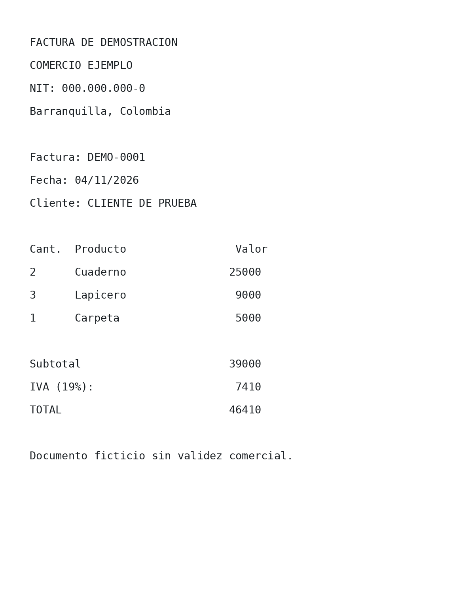
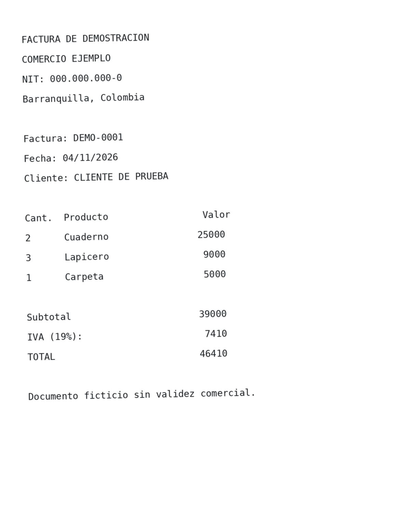
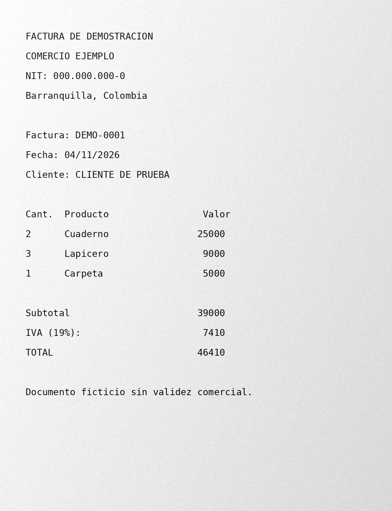

<div align="center">

# OpenScan OCR

**De documentos escaneados a texto utilizable.**

OCR abierto para imágenes y PDF: investigación reproducible, motor reutilizable y una interfaz web lista para probar.

[](https://github.com/isyoimerr/openscan-ocr/actions/workflows/ci.yml)


[**Ver el cuaderno en Colab**](https://colab.research.google.com/github/isyoimerr/openscan-ocr/blob/main/research/openscan_public_demo.ipynb) · [Instalación](docs/INSTALL.md) · [Despliegue en Render](docs/DEPLOY_RENDER.md) · [Método de evaluación](docs/METHODOLOGY.md) · [Roadmap](docs/ROADMAP.md)

</div>

---

## ¿Qué problema resuelve?

Muchos documentos llegan como una foto o un PDF escaneado: se ven, pero su texto no se puede buscar, copiar ni analizar fácilmente. OpenScan convierte esos archivos en **texto, datos exportables y PDF buscables**, sin exigir a las personas aprender a programar.

La herramienta utiliza **Tesseract de forma local, sin clave API**, y permite comparar el resultado con **Gemini** opcionalmente si el responsable configura una clave en el servidor.

### Funciones disponibles

| Función | Estado |
| --- | --- |
| Leer PNG, JPG, WEBP y PDF escaneados | Disponible |
| Procesar varios documentos y páginas | Disponible |
| Probar original, gris, Otsu y adaptativa | Disponible |
| Seleccionar PSM e idioma de Tesseract | Disponible |
| OCR con Gemini (opcional, por API) | Disponible, condicionado a acceso a API |
| Comparar tiempo y error CER/WER con referencia | Disponible |
| Descargar CSV y transcripciones TXT en ZIP | Disponible |
| Generar PDF con texto buscable (Tesseract) | Disponible |
| Validación humana de campos y extracción estructurada | Planificado |

## Ejecutar en 3 pasos

Necesitas Python 3.10+ y el programa **Tesseract OCR** instalado en el equipo.

```bash
# Ubuntu / Debian
sudo apt-get update
sudo apt-get install -y tesseract-ocr tesseract-ocr-spa

git clone https://github.com/isyoimerr/openscan-ocr.git
cd openscan-ocr
python -m pip install -e '.[web]'
streamlit run app/streamlit_app.py
```

Abre la dirección local que muestre Streamlit, sube una imagen o PDF y presiona **Procesar documentos**. Para Windows, macOS y despliegue web consulta [la guía](docs/INSTALL.md).

> **Privacidad:** en la aplicación web, Tesseract procesa los archivos en el **servidor** (no en el dispositivo del visitante). No subas documentos sensibles a una demo pública. Gemini está desactivado por defecto para evitar consumo no autorizado de la API. Si el responsable lo activa, los documentos elegidos para ese motor se envían también a Google.

### Tambien desde la terminal

```bash
openscan-ocr examples/facturas_demo_3paginas.pdf --pdf-buscable
```

Esto genera archivos de texto, CSV y PDF buscable en `results_local/`.

## Investigación abierta: ¿cómo se evaluó?

El repositorio incluye **3 variaciones sintéticas de una factura** y su transcripción de referencia. Se ejecutaron 27 pruebas con Tesseract: 3 imágenes × 3 métodos de preprocesamiento × 3 PSM.

| Configuración | CER medio en las pruebas de ejemplo |
| --- | ---: |
| Sin binarización | 1,67 % |
| Otsu | 1,15 % |
| Adaptativa | 1,15 % |
| PSM 4 (todos los tratamientos) | 0,11 % |
| PSM 6 (todos los tratamientos) | 0,04 % |
| PSM 11 (todos los tratamientos) | 3,81 % |

**Importante:** estos resultados corresponden únicamente a documentos artificiales creados para el proyecto; **no son evidencia de precisión real con cualquier documento**, ni una comparación general entre Gemini y Tesseract. El CER requiere un texto de referencia fiable. [Consulta los datos originales](research/resultados_tesseract.csv) y [la metodología](docs/METHODOLOGY.md).

Reproduce el experimento:

```bash
python research/run_benchmark.py
```

O utiliza [el cuaderno público de Google Colab](research/openscan_public_demo.ipynb), sin necesidad de instalar nada en tu computador. El uso de Gemini es opcional y requiere clave propia.

### Documentos de prueba

<details>
<summary>Ver muestras generadas (datos ficticios)</summary>





</details>

## Estructura del proyecto

```text
openscan-ocr/
  app/          Interfaz Streamlit
  src/openscan/ Motor OCR, PDF, CLI, preprocesamiento y exportacion
  research/     Cuaderno publico y datos de pruebas reproducibles
  examples/     Imagenes, PDF y textos totalmente ficticios
  tests/        Pruebas automatizadas
  docs/         Metodologia, instalacion, hoja de ruta y seguridad
```

## Tecnologías

Python · Tesseract · OpenCV · PDFium · Streamlit · Pandas · Google Gen AI SDK (opcional).

## Publicar tu propio repositorio

Consulta [la guia de publicacion](docs/PUBLISH_TO_GITHUB.md).

## Contribuir

Aceptamos mejoras de preprocesamiento, idiomas, pruebas con documentos **anonimizados** y mejoras de experiencia de usuario. Consulta [CONTRIBUTING.md](CONTRIBUTING.md), abre un [issue](https://github.com/isyoimerr/openscan-ocr/issues) o propone un pull request.

**Estado:** prototipo funcional `v0.1.0`, preparado para despliegue de demostración en Render. No incluye autenticación, cuotas por usuario ni protección contra abuso; consulta [ROADMAP](docs/ROADMAP.md) antes de utilizarlo en producción.

**Licencia:** [MIT](LICENSE).
