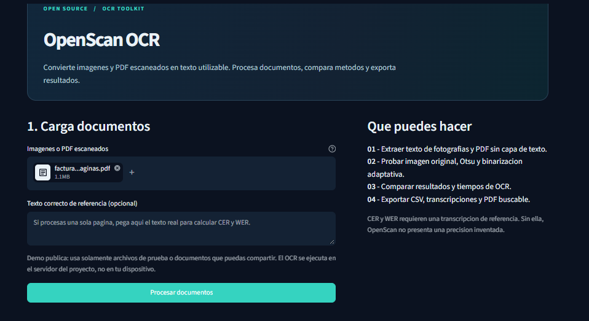

<p align="center">
  
</p>

<h1 align="center">OpenScan OCR</h1>

<p align="center">
  <strong>OCR abierto para documentos escaneados, imágenes y flujos reproducibles.</strong><br />
  <a href="https://openscan-ocr.onrender.com/">Probar demo</a> ·
  <a href="https://colab.research.google.com/github/isyoimerr/openscan-ocr/blob/main/research/openscan_public_demo.ipynb">Abrir en Colab</a> ·
  <a href="research/ANALISIS_RESULTADOS.md">Ver investigación</a> ·
  <a href="CONTRIBUTING.md">Contribuir</a>
</p>

OpenScan OCR es un toolkit de código abierto para convertir PDFs y fotografías escaneadas en texto usable, datos exportables y documentos PDF buscables. Está pensado como una base técnica reutilizable para automatizar la lectura de documentos, comparar métodos y documentar resultados con evidencia reproducible.

> La demostración pública ejecuta Tesseract en el servidor del proyecto. Gemini no está activo por defecto y no forma parte de la experiencia pública.

---

## Problema y propuesta

Muchos documentos llegan como imágenes o PDFs escaneados: se visualizan, pero su contenido no es searchable, editable ni fácil de procesar automáticamente. OpenScan aporta una pila ligera para:

- leer imágenes y PDFs escaneados;
- aplicar preprocesamiento para mejorar la OCR;
- elegir modos de segmentación y lenguaje;
- exportar texto, CSV y PDF buscable;
- comparar resultados de forma transparente con métricas como CER y WER.

La propuesta no promete exactitud universal. La intención es ofrecer una base clara, abierta y verificable para documentos de tipo administrativo o documental, con límites explícitos y resultados reproducibles.

## Qué incluye hoy

| Capacidad | Estado |
| --- | --- |
| Lectura de PNG, JPG, WEBP y PDF escaneados | Disponible |
| Procesado por páginas y lotes pequeños | Disponible |
| Preprocesamiento original, gris, Otsu y adaptativo | Disponible |
| Selección de PSM y idioma Tesseract | Disponible |
| Comparación de tiempos y métricas CER/WER con referencia | Disponible |
| Exportación a CSV, TXT y ZIP | Disponible |
| Generación de PDF con texto buscable | Disponible |
| Gemini opcional por API | Beta / solo si se configura el servidor |
| Revisión humana de campos o extracción estructurada | Planificado |

---

## Arquitectura y funcionamiento

OpenScan está organizado como una herramienta técnica incremental, no como un servicio de precisión mágica.

1. Entrada: imágenes o PDFs de origen escaneado.
2. Preprocesamiento: ajusta brillo, contraste, normalización, binarización y limpieza antes del OCR.
3. Motor OCR: usa Tesseract local como base; el motor puede combinarse con Gemini si el operador lo habilita explícitamente.
4. Métricas: cuando hay texto de referencia, calcula CER, WER y tiempos de ejecución.
5. Exportación: genera resultados para análisis, comparación y reutilización.
6. Interfaz: una app web con Streamlit para probar rápidamente el flujo sin necesidad de programar.

La lógica principal vive en [src/openscan](src/openscan), y la interfaz de prueba en [app/streamlit_app.py](app/streamlit_app.py).

---

## Investigación y evidencia técnica

Este repositorio incluye una línea de investigación reproducible basada en documentos sintéticos creados para el proyecto. El foco está en documentar cómo cambian los resultados al variar los parámetros del preprocesamiento y la segmentación.

La ejecución actual usa 27 combinaciones:

- 3 imágenes sintéticas 
- 3 métodos de preprocesamiento
- 3 modos PSM de Tesseract

Los indicadores principales son CER y WER frente a una referencia conocida. El repositorio deja claro que estos resultados no deben interpretarse como métricas universales para cualquier documento real.

| Configuración | CER medio |
| --- | ---: |
| Sin binarización | 1.67 % |
| Otsu | 1.15 % |
| Adaptativa | 1.15 % |
| PSM 4 | 0.11 % |
| PSM 6 | 0.04 % |
| PSM 11 | 3.81 % |

Estos valores se basan en documentos sintéticos y sirven para validar la metodología, no para afirmar precisión general. La explicación completa está en [research/ANALISIS_RESULTADOS.md](research/ANALISIS_RESULTADOS.md) y [docs/METHODOLOGY.md](docs/METHODOLOGY.md).

### Reproducir el benchmark

```bash
python research/run_benchmark.py
```

También puedes probar el flujo completo en Google Colab:

- [Colab público](https://colab.research.google.com/github/isyoimerr/openscan-ocr/blob/main/research/openscan_public_demo.ipynb)
- [Resultados de referencia](research/resultados_tesseract.csv)

---

## Evolución del desarrollo y versiones

OpenScan nace como una herramienta práctica y modular, con una iteración clara del producto:

- v0.1.0: motor OCR local reutilizable, benchmark reproducible, interfaz web, exportación y documentación base.
- v0.2: mejor calidad de experiencia, revisión del texto y análisis visual más sólido.
- v0.3: extracción de campos y salida estructurada.
- v1.0: estabilización, despliegue serio y gobernanza técnica.

El roadmap de evolución está en [docs/ROADMAP.md](docs/ROADMAP.md).

---

## Prototipo web y funcionalidades reales

La aplicación web demuestra el flujo completo de uso real: carga documentos, ajusta parámetros, procesa el OCR y exporta entregables.

<p align="center">
  
</p>

### Ejemplo de flujo

1. Subir una imagen o PDF escaneado.
2. Elegir método de preprocesamiento y modo Tesseract.
3. Añadir referencia opcional para calcular CER y WER.
4. Ejecutar el proceso y revisar resultados.
5. Exportar CSV, ZIP y PDF buscable.

> La demo pública usa Tesseract en el servidor del proyecto. No subas documentos sensibles ni personales a una instancia pública.

---

## Instalación y uso local

### Requisitos

- Python 3.10+
- Tesseract OCR instalado y accesible en el `PATH`
- Un navegador actualizado

### Linux / Ubuntu

```bash
sudo apt-get update
sudo apt-get install -y tesseract-ocr tesseract-ocr-spa
python -m venv .venv
source .venv/bin/activate
python -m pip install -e '.[web]'
streamlit run app/streamlit_app.py
```

### Windows

```powershell
py -m venv .venv
.venv\Scripts\Activate.ps1
python -m pip install -e ".[web]"
streamlit run app/streamlit_app.py
```

### macOS

```bash
brew install tesseract tesseract-lang
python3 -m venv .venv
source .venv/bin/activate
python -m pip install -e '.[web]'
streamlit run app/streamlit_app.py
```

Más detalles en [docs/INSTALL.md](docs/INSTALL.md).

### Google Colab

El cuaderno público permite probar el proyecto sin preparar un entorno local:

- [Abrir en Colab](https://colab.research.google.com/github/isyoimerr/openscan-ocr/blob/main/research/openscan_public_demo.ipynb)

### Gemini opcional

Gemini es un motor adicional, no un requisito. Si se habilita, debe configurarse explícitamente con secretos del entorno o de la instancia privada. En la demo pública queda desactivado.

---

## Roadmap, licencia y contribuciones

### Roadmap

- Mejoras de calidad en la experiencia y revisión del texto.
- Corrección de orientación y preparación de documentos.
- Extracción estructurada de campos y salidas JSON/CSV.
- Mayor variedad de datasets y validación reproducible.

Consulta [docs/ROADMAP.md](docs/ROADMAP.md).

### Contribuir

Las contribuciones bienvenidas incluyen:

- mejoras de preprocesamiento;
- soporte de nuevos idiomas y modos OCR;
- validación de casos del mundo real con documentos autorizados y anonimizados;
- mejoras en UX, accesibilidad y documentación.

Consulta [CONTRIBUTING.md](CONTRIBUTING.md) y abre una incidencia o PR en GitHub.

### Licencia

OpenScan OCR se distribuye bajo la licencia [MIT](LICENSE).

---

<p align="center">
  
</p>

<p align="center">
  <a href="https://openscan-ocr.onrender.com/">Demo</a> ·
  <a href="https://colab.research.google.com/github/isyoimerr/openscan-ocr/blob/main/research/openscan_public_demo.ipynb">Colab</a> ·
  <a href="research/ANALISIS_RESULTADOS.md">Investigación</a> ·
  <a href="CONTRIBUTING.md">Contribuir</a>
</p>
